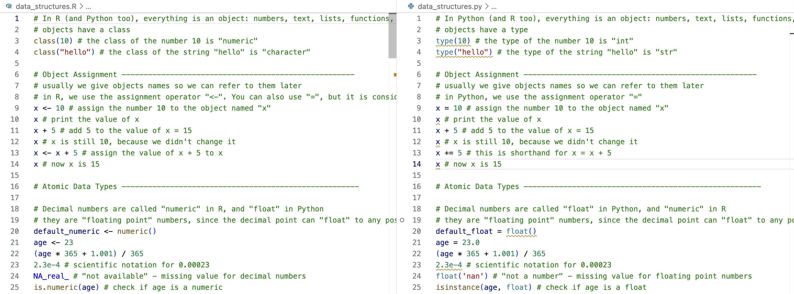

# Data Science Basics with Parallel R and Python

This course introduces the fundamentals of R and Python programming for data science. As much as possible, each line of code is written in parallel in R and Python, like so:

> [!WARNING]
> These scripts are designed to be explored interactively, to get hands-on experience with the two languages. They do not resemble the kind of code or file structure you would see in a real data analysis project.

## Contents

1.  Object Types and Data Structures [R](data_structures.R) \| [py](data_structures.py)
2.  Functions, Methods, and Testing [R](functions.R) \| [py](functions.py)
3.  Control Flow [R](control_flow.R) \| [py](control_flow.py)
4.  Computational Complexity and Memory Constraints [R](computational_complexity.R) \| [py](computational_complexity.py)
5.  Dependencies [R](dependencies.R) \| [py](dependencies.py)
6.  Numerical Data [R](numerical_data.R) \| [py](numerical_data.py)
7.  Reproducibility [R](reproducibility.R) \| [py](reproducibility.py)
8.  Tabular Data [R](tabular_data.R) \| [py](tabular_data.py)
9.  Files and the Operating System [R](files.R) \| [py](files.py)
10.  Web APIs [R](web_apis.R) \| [py](web_apis.py)
11. Scraping [R](scraping.R) \| [py](scraping.py)
12. Visualization [R](visualization.R) \| [py](visualization.py)